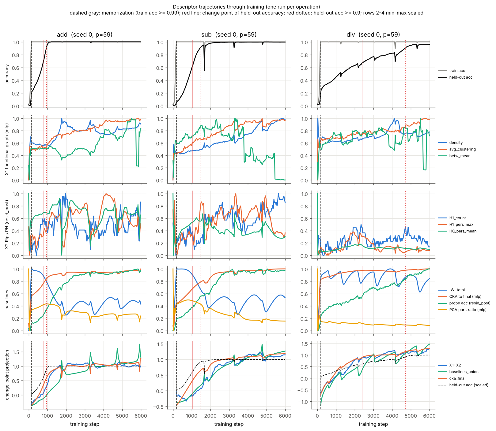
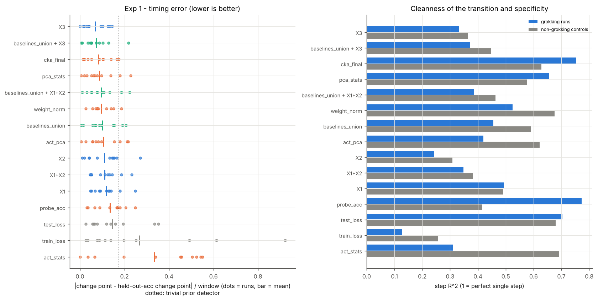
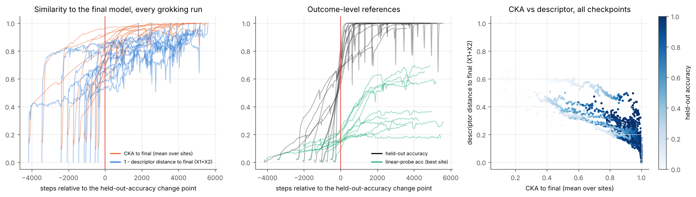
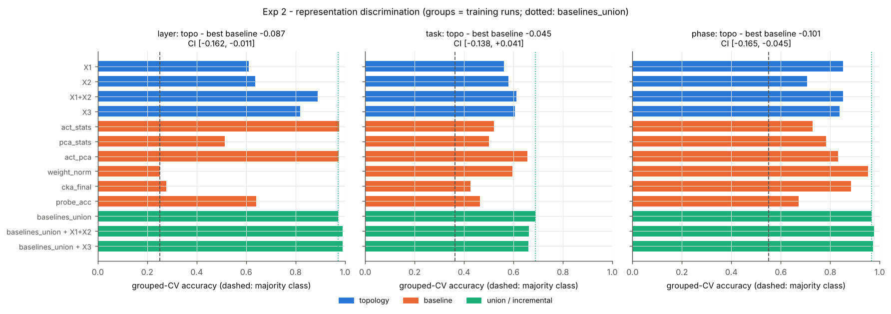
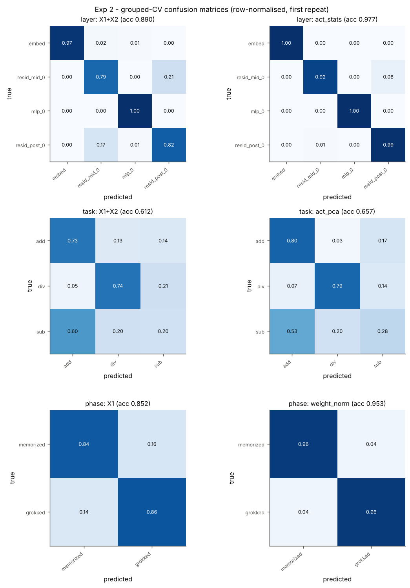
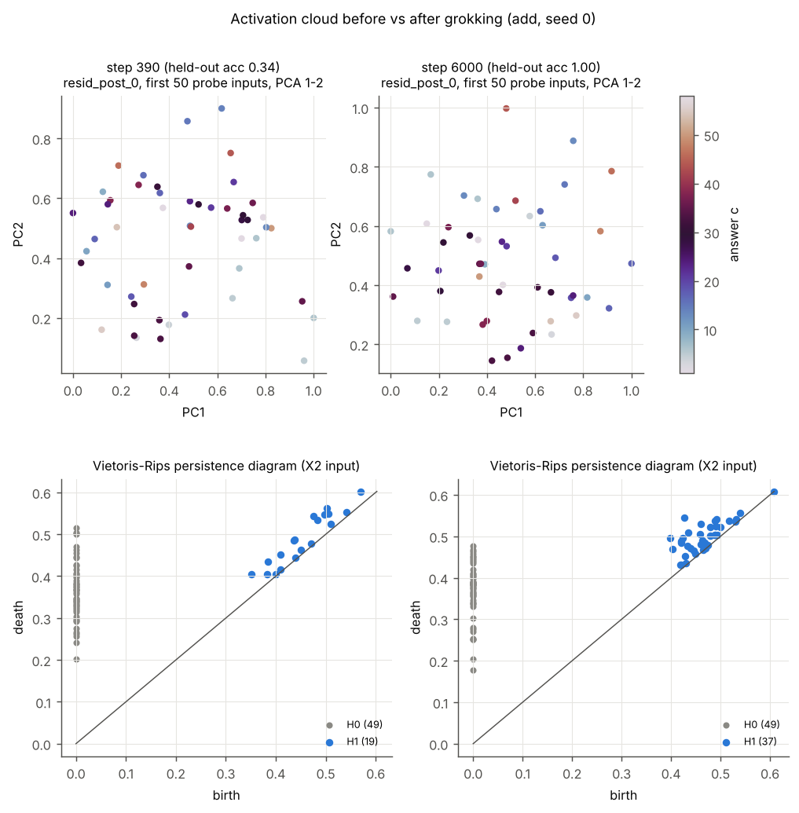

# Results: the topological-spectral descriptor across grokking

Run: `python -m tsi.run --config configs/full.yaml`. Every number below comes
from [`results/results.md`](../results/results.md) /
[`results/results.json`](../results/results.json). Background and protocol are
in [`SCIENCE.md`](SCIENCE.md).

## Verdict

**NO-GO on both experiments.** The authentic descriptor (X1, X2, X1+X2, X3)
sees the grokking transition: its trajectories change around it, and it
classifies layers, tasks and phases far above chance. But it never beats the
strongest baselines by the pre-registered +0.05 with a CI above 0, and it
never adds that much to them.

The best case for topology is a **tie** in locating the transition. X3 has
the lowest timing error of all 13 signals, but the margin over CKA-to-final
is not significant.

| Question | best topology | best baseline | margin (topology better > 0) [95 % CI] | verdict |
|---|---|---|---|---|
| 1a. Locates the transition (timing error) | X3 0.068 | CKA to final 0.083 | +0.015 [-0.017, +0.052] | NO-GO (tie) |
| 1b. Cleaner step (step R^2) | X1 0.494 | probe acc 0.772 | -0.278 [-0.329, -0.229] | NO-GO (worse) |
| 1c. Early warning (R^2, steps to grokking) | X2 -0.440 | weight norm -0.083 | -0.357 [-0.892, +0.649] | NO-GO (nothing predicts it) |
| 1d. Adds to the best baseline (timing) | CKA + X3 | CKA | +0.006 [-0.017, +0.028] | NO-GO |
| 2a. Layer (4 sites) | X1+X2 0.890 | act stats 0.977 | -0.087 [-0.162, -0.011] | NO-GO (worse) |
| 2b. Task (add / sub / div) | X1+X2 0.612 | act stats + PCA 0.657 | -0.045 [-0.138, +0.041] | NO-GO (tie) |
| 2c. Memorized vs grokked | X1 0.852 | weight norm 0.953 | -0.101 [-0.165, -0.045] | NO-GO (worse) |
| 2. Adds to all baselines (best task: phase) | union + X1+X2 0.977 | union 0.967 | +0.010 [+0.000, +0.022] | NO-GO (real but tiny) |

**Units.** For 1a the numbers are timing errors (|detected change point -
held-out-accuracy change point| / window, window ~ 5800 steps), so lower is
better. A margin of 0.015 is about 90 steps. For 1b the numbers are step R^2,
for 1c out-of-fold R^2, and for Experiment 2 grouped-CV accuracy.

**In one sentence.** The topology of the activations changes when grokking
happens, but so do much simpler things. CKA to the final model, PCA
dimension and weight norm locate the transition as well. Probe accuracy and
CKA mark it more sharply. All of them do so more specifically to grokking.

## Runs

Fifteen one-layer transformers were trained from scratch: p = 59, d_model
128, 4 heads, 512 MLP units, full-batch AdamW (lr 1e-3, weight decay 1.0),
6000 steps, checkpoints every 30 steps. The answer is read at the `=` token.

| op | train fraction | runs | grokked (delayed generalization) | t_mem (steps) | t_grok, held-out >= 0.9 (steps) |
|---|---|---|---|---|---|
| add | 0.50 | 4 | 4 | 150 | 960, 1380, 1770, 2310 |
| sub | 0.60 | 4 | 3 (s1 reached 0.854) | 180 | 450, 1440, 4800 |
| div | 0.55 | 4 | 4 | 180-240 | 690, 3570, 4110, 4710 |
| controls (weight decay 0) | as op | 3 | 0 (held-out 0.08-0.30 at the end) | 150-180 | - |

- **Sample size.** 11 grokking runs carry both experiments. Grokking time
  varies tenfold across seeds (450-4800 steps), so a fixed "grokking epoch"
  cannot be guessed. The trivial prior detector (the mean position of the
  other runs) has a timing error of 0.176.
- **What "grokked" means here.** We require held-out accuracy still < 0.5 at
  memorization (train accuracy >= 0.99), then >= 0.9.
- **`div` is gradual.** Held-out accuracy rises over 2000-4000 steps rather
  than in a jump (see `descriptor_trajectory.png`).

### Pilot (why these settings)

Before the full run we calibrated p, width and train fraction in short pilot
runs. These are not in `results/`; they were run with the same code.

- At train fraction 0.4, `add` had not generalized after 5000 steps
  (held-out 0.13).
- At 0.5, `add` grokked by about step 1000-1400. `sub` stayed at chance for
  3000 steps, even with weight decay 2. `div` was still at 0.06 after 2000
  steps. `mul` rose gradually to 0.67 with no plateau.
- At 0.6, `add` generalized almost together with memorization (steps 200 /
  300). `mul` memorized late (steps 1100-2400), together with generalizing.
- `mul` (with its zero row and column) therefore never showed delayed
  generalization in this budget. It was replaced by Power et al.'s `div`.
- The train fraction is set **per operation** so that each one groks within
  6000 CPU steps. This confounds `task` with train fraction in Experiment 2
  (see Limitations).

## Experiment 1: does the descriptor detect grokking?

The same label-free single change-point detector runs on every signal
(trajectory over checkpoints, all four sites concatenated, window
[t_mem, t_end]). It is scored against the change point that the detector
finds in held-out accuracy.



| signal | mean timing error | median | runs within 0.05 | mean signed lag | step R^2 (grok runs) | step R^2 (controls) |
|---|---|---|---|---|---|---|
| **X3** | **0.068** | **0.041** | **55 %** | +0.039 | 0.33 | 0.36 |
| CKA to final | 0.083 | 0.088 | 36 % | -0.014 | 0.75 | 0.63 |
| PCA stats | 0.087 | 0.067 | 27 % | +0.086 | 0.66 | 0.58 |
| weight norm | 0.097 | 0.077 | 9 % | +0.048 | 0.52 | 0.68 |
| baselines_union | 0.100 | 0.088 | 18 % | +0.100 | 0.46 | 0.59 |
| act stats + PCA | 0.105 | 0.082 | 18 % | +0.104 | 0.42 | 0.62 |
| X2 | 0.110 | 0.134 | 36 % | +0.080 | 0.24 | 0.31 |
| X1+X2 | 0.111 | 0.113 | 18 % | +0.091 | 0.35 | 0.38 |
| X1 | 0.118 | 0.119 | 9 % | +0.096 | 0.49 | 0.49 |
| probe acc | 0.136 | 0.165 | 18 % | +0.136 | 0.77 | 0.42 |
| held-out loss (reference) | 0.144 | 0.119 | 9 % | +0.144 | 0.70 | 0.68 |
| trivial prior | 0.176 | 0.131 | | | | |



**1a. Timing: a tie.** X3 places the transition closest to the held-out
change point: lowest mean and median error, and the most runs within 5 % of
the window.

- vs CKA to final: +0.015 [-0.017, +0.052]. CKA is retrospective: it needs
  the final model.
- vs the best *causal* baseline, PCA statistics: +0.019 [-0.019, +0.055].
- vs the linear probe: +0.068 [+0.025, +0.106].

Both CIs include 0 (and +0.05). Only the linear probe is clearly beaten, and
it is not the strongest baseline. Per operation, X3 is better than CKA on `div` (0.071 vs
0.124), worse on `sub` (0.110 vs 0.088), and equal on `add` (0.033 vs
0.038). Adding X3 to CKA changes the timing error by +0.006
[-0.017, +0.028].

**1b. Cleanness: worse.** Topological trajectories are noisy. X2 summarises
the Rips persistence of only 50 points (the original setting), so it jitters
from checkpoint to checkpoint. The best topological step R^2 (X1, 0.49) is
far below the linear probe (0.77) and CKA (0.75).

**Specificity: not specific to grokking.** In the three controls, which
memorize and never generalize, the topological views show steps exactly as
strong as in grokking runs (controls vs grokking runs: X1 0.49 vs 0.49;
X3 0.36 vs 0.33). Where in time their trajectory changes is a
training-dynamics change, not a grokking change. The *amount* of change at
one site does differ; see "What the descriptor does see".

- The linear probe is the most grokking-specific signal (0.77 vs 0.42),
  followed by CKA (0.75 vs 0.63) and PCA statistics (0.66 vs 0.58).
- Weight norm and raw activation statistics step *more* in the controls,
  because without weight decay their norms keep growing.

**1c. Early warning: nothing works, topology included.** On 439
memorization-plateau checkpoints we predicted the steps remaining until
held-out accuracy reaches 0.9, leave-one-run-out. Every feature set has
out-of-fold R^2 < 0: weight norm -0.08, training step -0.21, X2 -0.44,
X3 -0.99, CKA -1.44. The time at which a run will grok is not readable from
its plateau representation across seeds, at least with 11 runs and these
summaries. No descriptor or baseline signal's 10 % onset leads held-out
accuracy by more than 1.5 % of the window either. Only the train-loss
reference moves earlier, because it keeps falling throughout. The topological views move *after* held-out accuracy
starts to rise (signed lags +0.04 to +0.10).

**1d. Increment: none.** (Best baseline + best topological view) vs the best
baseline: timing +0.006 [-0.017, +0.028], step R^2 -0.261, early warning
-0.427. The secondary comparison (baselines_union + topology vs
baselines_union) is also NO-GO on every criterion. It is not used for the
verdict: a concatenation of heterogeneous baselines is a worse change-point
detector (0.100) than its best member (0.083), so beating it would not show
that topology adds anything.



**CKA vs descriptor.**
- *Left panel:* both similarities to the final model rise through the
  transition. The descriptor curves (1 - distance of X1+X2 to its final
  value) are noisier and keep drifting after grokking. The right-hand
  scatter shows them strongly, but not perfectly, (inversely) related.
- *Middle panel:* the linear-probe ceiling is low (0.2-0.7 after grokking,
  vs held-out accuracy 1.0). A 59-way ridge probe on 512 training inputs per
  fold is under-powered. It still marks the transition most sharply.

## Experiment 2: what do activation descriptors discriminate?

Samples are (run, checkpoint, site) from the 11 grokking runs, at or after
memorization (1600-1760 samples, 40 checkpoints per run). The evaluation is
the GEM protocol: StratifiedGroupKFold with groups = training runs
(4 folds x 3 repeats), LogReg + 200-tree random forest, and paired
run-bootstrap CIs.

| feature set | layer (4 sites) | task (3 ops) | phase (mem. vs grokked) |
|---|---|---|---|
| X1 | 0.611 | 0.562 | **0.852** |
| X2 | 0.636 | 0.580 | 0.707 |
| X1+X2 | **0.890** | **0.612** | 0.851 |
| X3 | 0.819 | 0.606 | 0.838 |
| act stats | 0.977 | 0.521 | 0.728 |
| PCA stats | 0.513 | 0.500 | 0.783 |
| act stats + PCA | 0.975 | 0.657 | 0.832 |
| weight norm | 0.250 | 0.596 | 0.953 |
| CKA to final | 0.278 | 0.426 | 0.885 |
| probe acc | 0.641 | 0.464 | 0.673 |
| baselines_union | 0.973 | 0.688 | 0.967 |
| union + X1+X2 | 0.990 | 0.662 | 0.977 |
| union + X3 | 0.991 | 0.661 | 0.973 |
| training step alone (trivial reference) | 0.250 | 0.624 | 0.897 |
| majority class | 0.250 | 0.364 | 0.550 |




**2a. Layer: topology works but loses.** X1+X2 identifies the site with 0.89
accuracy. `embed` and `mlp_0` are near-perfect; the two residual-stream
sites get confused (`resid_mid_0` vs `resid_post_0`). Raw activation
statistics are almost perfect (0.977): the mean, sparsity and dead-unit
fraction identify a ReLU layer and an embedding trivially. Union + X3 reaches
0.991 (+0.018 [-0.021, +0.075]). The headroom (0.027) makes an incremental
GO arithmetically impossible.

**2b. Task: a tie, and all weak.**
- Scores: X1+X2 0.612 vs activation stats + PCA 0.657
  (-0.045 [-0.138, +0.041]); union 0.688.
- Both confuse `sub` with `add` (topology sends 60 % of `sub` samples to
  `add`) and separate `div` better. `add` and `sub` are the same cyclic group
  acting on the same token labels. `div` is the multiplicative group, whose
  embedding must first learn a discrete-log-like relabeling of the tokens.
- The training step alone reaches 0.624, because the operations grok at
  different times and use different train fractions. Task decoding here is
  therefore partly a timing / data-fraction confound, for every feature set.

**2c. Memorized vs grokked: topology works but loses.**
- Scores: X1 0.852 vs weight norm 0.953; the union reaches 0.967.
- The training step alone reaches 0.897. Weight decay shrinks the weights
  monotonically, and grokked checkpoints come later.
- Adding X1+X2 to the union gives +0.010 [+0.000, +0.022]. This is the only
  increment whose CI clears 0, but it is a fifth of the +0.05 bar and the
  headroom is only 0.033.

## What the descriptor does see

- **X1 (functional graph)** carries most of the signal, and the clearest
  effect is at the embedding. Post-hoc check from the cache:
  - The X1 edge density of the 80 embedding dimensions rises from about
    0.02 at memorization to 0.21-0.62 at the end of every grokking run.
  - In the three controls it only reaches 0.03-0.04. The partially
    generalized `sub` s1 (held-out 0.85) ends in between, at 0.23.
  - This is the graph-side view of the embedding collapsing onto a few
    Fourier directions (Nanda et al. 2023): dimensions that share a
    frequency become correlated.
  - A simple baseline shows the same thing at least as well. The PCA
    participation ratio of the embedding ends at 3-10 in grokking runs and
    21-24 in controls, and weight norm separates them as well (30-40 vs
    54-57).
  - Two caveats. The controls also differ in weight decay, so this
    comparison cannot separate "grokked" from "trained with weight decay".
    Over the whole trajectory, MLP and residual density and clustering also
    drift in the controls.
- **X2 (Rips persistence of 50 points)** is the weakest view.
  - The grokked representation of `c` is a curve on a torus spanned by
    several key frequencies. The original 50-point / 15-PC setting cannot
    resolve it: after grokking H1 bars become more numerous (19 -> 37 in the
    `add` example of `activation_topology.png`) but stay short, and no single
    ring appears in the top-2 PCs.
  - A larger point sample or a filtration adapted to circular structure
    might do better. That would be a different, post-hoc descriptor; the
    pre-registered one is the authentic one.
- **X3 (fusion)** gives the best timing because the L2 normalisation
  equalises the two views. It inherits X2's noise.



## Limitations and threats to validity

- **Scale.** 11 grokking runs of one architecture at one p. The run-level
  bootstrap CIs are correspondingly wide, so a true topology advantage
  smaller than about 0.05 could be missed. None larger is supported.
- **Task / train-fraction confound** (Experiment 2b): the train fraction is
  per operation. It affects every feature set equally, but it makes task
  decoding partly a dynamics decoding.
- **Baselines.**
  - CKA-to-final is retrospective: it needs the final checkpoint.
  - The ridge probe is under-powered for 59 classes. A stronger probe would
    only widen the baselines' lead in cleanness.
- **Detector choices.**
  - One change point per window, with the held-out-accuracy change point as
    reference. `t_grok` (held-out >= 0.9) is also reported per run.
  - The window is dominated by the post-grokking period.
  - A different detector could rank signals differently; the same detector
    was applied to all.
- **Authentic hyperparameters were not tuned:** theta = 0.40, an 80-unit cap
  (of 512 MLP units), 50 points and 15 PCs for X2. A sensitivity sweep would
  be post hoc, and the GEM experience suggests richer topology tends to reach
  parity, not superiority.
- **Out of scope.** Larger models, LayerNorm, other grokking settings
  (non-algorithmic data, Liu et al. 2023) and Fourier-based progress
  measures (restricted / excluded loss, Nanda et al. 2023). The latter are
  the natural, mechanism-aware baselines to add next.

## Reproduce

```bash
python -m tsi.run --config configs/full.yaml                  # ~1 h on 4 cores; caches runs in data/
python -m tsi.run --config configs/full.yaml --figures-only   # redraw figures from results.json + cache
```
